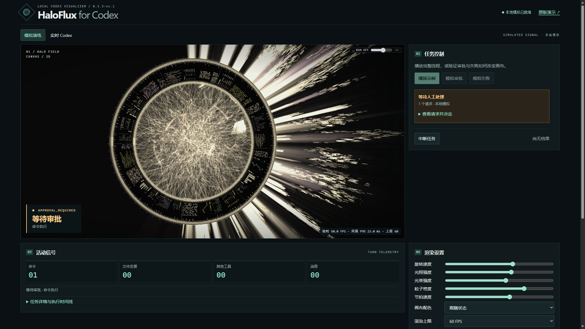
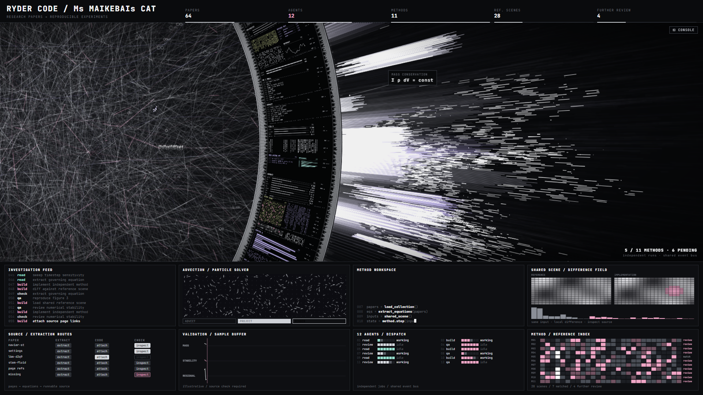

# HaloFlux for Codex v0.3.3-rc.1

Original HALOFLUX by Ryder191 (RYDER CODE / Ms MAIKEBAIs CAT). [原始仓库](https://github.com/Ryder191/haloflux)

Codex integration and additional development by Li Xian（李显）.

HaloFlux for Codex is an unofficial, non-commercial project. [English guide](#english-guide)

HaloFlux for Codex 是非官方、仅限非商业用途的 HaloFlux 衍生项目。它通过本机 Codex App Server 执行任务，用原版 Canvas 展示状态。使用和分发须遵守原始 PolyForm Noncommercial License 1.0.0 及 Required Notice。 [许可证](LICENSE) · [署名](NOTICE.md)

## Windows 快速开始

解压 Windows ZIP，安装 Node.js 22 或更新版本，再双击 `Start-HaloFlux.cmd`。启动器会检查运行环境并打开默认浏览器。实时模式还需要安装 Codex CLI 并登录。启动器检测不到 CLI 或登录时，仍可进入模拟模式。项目无第三方运行时依赖。

启动器中输入 `Q` 并回车即可关闭桥接。开发者可在项目目录运行 `npm.cmd start`，访问本地地址 `http://127.0.0.1:4637`，按 `Ctrl+C` 停止服务。自定义工作目录、端口和 CLI 路径见 [Windows 使用说明](docs/WINDOWS.md)。

本包为 Windows 发布候选版。npm Codex CLI 0.162.0 通过本版 Schema 检查与隔离握手。该 CLI 在此前的本机实测中遇到 Windows 沙箱 Error 32。0.163.0 仅完成官方发布元数据与标签 Schema 核对，实机验证待授权。 [Windows CLI 兼容性报告](docs/SANDBOX.md)

有头 Edge 回归分别检查 SSE 建连、刷新、模式切换、并发模拟审批、可见性和绘制恢复。各版本 1080p 固定档与自动档的实测数据、质量切换及帧间隔见性能报告。 [双标签排查](docs/DUAL-TAB.md) · [性能对照](docs/PERFORMANCE.md)

## 使用界面

- **模拟演练**。用示例观察命令、文件、消息、完成和失败状态，也可以演练人工审批。模拟事件和真实事件分开记录。
- **实时 Codex**。连接后可创建线程、分页浏览并恢复已有线程，或直接运行任务。任务运行中可中断。App Server 子进程退出后，桥接会尝试恢复当前线程。浏览器 SSE 断开时会自动重连。
- **人工审批**。展开请求，核对当前线程、任务、命令、目录、权限或只读补丁，再选择一次性决定。以当前 CLI 提供的决定为准。某些命令只提供「拒绝并中断」。预览不足、请求过期或任务已结束时无法批准。
- **任务详情与时间线**。主动打开可查看输入、回复、项目状态、审批结果和轮次终态。默认状态流只包含事件类别和计数。 [安全模型](docs/SECURITY.md)
- **画布**。完整构图是默认选项，也可切换原版艺术裁切。可调光环尺寸和位置、画布比例和高度策略、光束、粒子、文字与帧率。设置保存在当前浏览器。音乐默认关闭，原版独立演示仍可打开。
- **环境健康检查**。展开面板可检查 CLI、登录、连接、协议、沙箱错误和浏览器渲染环境。导出报告只包含版本、枚举状态、故障类别和渲染元数据。 [沙箱诊断](docs/SANDBOX.md)

以下截图由 Edge 实际渲染，内容为本地模拟。



[平板布局](docs/screenshots/tablet.png) · [模拟审批卡](docs/screenshots/simulated-approval.png)

## 测试与发布

```powershell
npm.cmd test
npm.cmd run check:source
npm.cmd run check:protocol
npm.cmd run check:cli
npm.cmd run test:windows
```

以上命令无需模型调用。Windows 沙箱诊断是单独运行的固定本机只读探针，可能触发 Codex runtime 初始化。真实模型测试由 `HALOFLUX_LIVE_TEST=1` 显式启用，使用已登录的 Codex 和独立临时目录。 [测试矩阵](docs/TESTING.md) · [验收记录](docs/VERIFICATION.md)

[架构说明](docs/ARCHITECTURE.md) · [更新日志](CHANGELOG.md)

## English guide

HaloFlux visualizes Codex task state with the original HALOFLUX Canvas. The local bridge streams status and counts to the browser. Open the task details or approval panel to inspect private content on demand. [Architecture](docs/ARCHITECTURE.md) · [Security](docs/SECURITY.md)

1. Verify the ZIP against its SHA-256 file. Extract it to a writable Windows folder and install Node.js 22 or newer.
2. Open `Start-HaloFlux.cmd` to start the bridge and launch your default browser. Type `Q` and press Enter in the launcher to stop it. From a terminal, `npm.cmd start` also serves the UI at `http://127.0.0.1:4637` and stops with Ctrl+C.
3. Use **模拟演练** (Demo) to try success, failure or an approval without a Codex account. For **实时 Codex** (Live), install the official CLI, sign in through `codex login` and select **连接 Codex** (Connect). Create, list or resume a thread, then run or interrupt a task.
4. In **查看请求并决定** (Review and decide), inspect the scoped command, permissions or patch. Choose a one-time decision offered for that request. Refresh restores the pending state, and a used or outdated approval ticket is rejected.

**The browser did not open.** Copy the loopback URL from the launcher. If the port is occupied, reuse the existing HaloFlux window or set `HALOFLUX_PORT` for a separate instance. The extracted folder is the default workspace. Pass a directory to `npm.cmd start -- "path to workspace"` to select another one. [Windows guide](docs/WINDOWS.md)

**Live tasks fail to start.** Check the health panel and `codex login status`. `npm.cmd run check:protocol` and `npm.cmd run check:cli` check the selected CLI without model use. The 0.162.0 CLI passed schema and handshake checks. A prior local run reproduced Windows sandbox Error 32. The 0.163.0 candidate awaits an authorized runtime check. Demo mode works independently. [Compatibility report](docs/SANDBOX.md)

Original HALOFLUX and its visual design are by Ryder191 (RYDER CODE / Ms MAIKEBAIs CAT). Codex integration and additional development are by Li Xian（李显）. The distribution follows the PolyForm Noncommercial License 1.0.0 and carries the original Required Notice and music attribution. [Upstream project](https://github.com/Ryder191/haloflux) · [License](LICENSE) · [Notices](NOTICE.md)

---

以下是原版 HALOFLUX README，保留原作者的说明和署名。

# HALOFLUX

> RYDER CODE / Ms MAIKEBAIs CAT

**English** | [中文](#中文说明)

A full-screen, beat-driven sci-fi data visualization — a woven light-field core, a rotating ring of micro data panels, and layered beams bursting outward. Pure native Canvas, single HTML file, zero dependencies.

> **Noncommercial use only. Any commercial use is strictly prohibited.** Free for personal study, hobby projects and private entertainment. See [License](#license).



## Files

| File | Description |
|---|---|
| `lab.html` | Desktop console edition (best at 16:9 full screen) |
| `mobile.html` | Mobile-compatible edition (portrait/landscape adaptive, lighter particle load) |
| `index.html` | Entry page: opens `mobile.html` on touch devices, `lab.html` otherwise |
| `audio/sw421k.mp3` | Background music (see Credits) |
| `wallpaper/` | Wallpaper Engine / Lively Wallpaper edition (see below) |

Showcase video: https://b23.tv/mBUoC3r

Steam Workshop (Wallpaper Engine): pending review — meanwhile, install it manually in one minute (see [Desktop wallpaper](#desktop-wallpaper)).

## Usage

- Just open the HTML file in Edge / Chrome / Safari.
- **Double-click** or press **F** — toggle full screen.
- Click **CONSOLE** (top-right) or press **C** — open the live tuning panel (56 parameters: beat tempo, ring speed, beam layers, glow, depth...).
- **Export / Import** settings as JSON. **Save as default** stores your tweak in the local browser.
- URL `?preset=a` / `?preset=b` switches to the built-in A (dark) / B (bright) presets.
- **Background music** is on by default. Browsers block sound until the first interaction, so the BGM button shows *CLICK / TAP TO PLAY* — any click, tap or key starts it. Toggle with the **BGM** button or **M**, set the volume with its slider (remembered per browser). On iPhone, music plays even with the silent switch on (iOS 17+).

Everyone who opens the page gets the baked-in default look ("我的默认").

## Highlights

- Uneven beat clock drives everything — nothing moves at constant speed.
- Ring rotates with stutter-stops, sprints and drifts; 12 kinds of pre-rendered micro data blocks.
- 5 stacked outer beam layers (far / mid / main / near / bounce wave), roots always attached to the ring.
- Auto camera with push-ins across 7 shots.

## Desktop wallpaper

The `wallpaper/` folder is a ready-to-use **Wallpaper Engine** web wallpaper (`project.json` + `index.html`). No mouse UI, works offline, pauses (visuals and music) when a fullscreen app covers it.

**Wallpaper Engine — manual install (no Workshop needed):**

1. Download **[HALOFLUX-wallpaper-engine.zip](https://github.com/Ryder191/haloflux/releases/latest/download/HALOFLUX-wallpaper-engine.zip)** and unzip it.
2. In your Steam Library, right-click *Wallpaper Engine* → *Manage* → *Browse local files*, then open `projects\myprojects` (create `myprojects` if it does not exist).
3. Put the whole `HALOFLUX` folder inside, so the path is `...\wallpaper_engine\projects\myprojects\HALOFLUX\project.json` (no extra nested folder).
4. Fully quit Wallpaper Engine (tray icon → *Quit*) and start it again. HALOFLUX appears in the *Installed* list — click it to apply.

You can also open it in the Wallpaper Engine editor to tweak it: *Open Wallpaper* → *Open from file* → pick `HALOFLUX\project.json`.

**Republishing on the Steam Workshop (or any wallpaper platform)** is allowed only if you:

- credit the author and the source **in the item description**: `Original work: HALOFLUX by Ryder191 (RYDER CODE / Ms MAIKEBAIs CAT)` · `Source: https://github.com/Ryder191/haloflux` (the bundled `project.json` already contains these lines — keep them);
- do not present it as your own, and mark modified versions as *modified from HALOFLUX*;
- make **no profit of any kind**: no paid items, paywalls, donation / tip / sponsor links, ads, paid bundles, or promotion of paid products.

Anything else is not permitted. See [LICENSE](LICENSE).

Other options:

- **Lively Wallpaper** (free): *Add wallpaper* → URL `https://ryder191.github.io/haloflux/wallpaper/`.
- **Steam Workshop**: the listing is pending review; this section will link to it once it is public.
- Settings: visual preset, tempo, ring speed (both default to a calm 0.6), auto camera on/off and camera intensity, glow, beam glow, scanlines, UI panels on/off (off = halo only), music on/off and volume.

## Community

Projects built on HALOFLUX by the community, maintained by their own authors (noncommercial, under the same license):

- **[dsh-haloflux](https://github.com/Ke-wood/dsh-haloflux)** by [@Ke-wood](https://github.com/Ke-wood): a DeepSeek Harness (DSH) plugin that turns HALOFLUX into a live background driven by the current agent session, with a settings page.

## Credits

Music: **"Synthwave 421k"** by The Cynic Project (cynicmusic), from the *Pixelsphere* soundtrack — released under **CC0** on [OpenGameArt](https://opengameart.org/users/cynicmusic).

## License

**Copyright (c) 2026 Ryder191 (RYDER CODE / Ms MAIKEBAIs CAT). All rights reserved.**

HALOFLUX — its source code and its audiovisual design (composition, motion design, beat-driven timing, layered beam system, ring and panel graphics, color treatment, layout and overall look and feel) — is an original work protected by copyright.

Licensed under the [PolyForm Noncommercial License 1.0.0](LICENSE):

- ✅ **Free for noncommercial use**: personal study, hobby projects, private entertainment, research and teaching. You may use, modify and share it.
- ❌ **Commercial use is strictly prohibited**, including use inside or on behalf of a company, integration into commercial products or services, client / paid work, selling the software or its outputs and derivatives (paid wallpapers, templates, assets, videos), and commercial advertising. No commercial licenses are offered.
- When sharing or remixing, keep the copyright notice and credit **"HALOFLUX by Ryder191 (RYDER CODE / Ms MAIKEBAIs CAT)"** with a link to this repository.
- Republishing on the Steam Workshop or other wallpaper platforms requires crediting the author and this repository in the item description, and no monetization of any kind (see [Desktop wallpaper](#desktop-wallpaper)).

Versions published before 2026-10-26 were released under MIT; from 2026-10-26 on, this project is licensed only under the terms above. The bundled music (`audio/sw421k.mp3`) is CC0 by its author and is not covered by this license.

---

## 中文说明

一个全屏、节拍驱动的科幻数据可视化：中心是编织状的光场核心，外面是一圈由微型数据面板组成的旋转圆环，环外有多层向外迸发的光束。纯原生 Canvas，单个 HTML 文件，零依赖。

> **仅限非商业用途，严格禁止任何商业用途。** 个人学习、兴趣项目、个人娱乐可免费使用。详见[许可证](#许可证)。

### 文件

| 文件 | 说明 |
|---|---|
| `lab.html` | 桌面控制台版（16:9 全屏效果最佳） |
| `mobile.html` | 移动端兼容版（横竖屏自适应，粒子负载更轻） |
| `index.html` | 入口页：触屏设备自动打开 `mobile.html`，其他设备打开 `lab.html` |
| `audio/sw421k.mp3` | 背景音乐（见「致谢」） |
| `wallpaper/` | 动态壁纸版（Wallpaper Engine / Lively Wallpaper，见下文） |

演示视频：https://b23.tv/mBUoC3r

Steam 创意工坊（Wallpaper Engine 壁纸）：审核中。现在可以先手动安装，一分钟搞定（见[桌面动态壁纸](#桌面动态壁纸)）。

### 使用方法

- 用 Edge / Chrome / Safari 直接打开 HTML 文件即可。
- **双击**画面或按 **F** 键：切换全屏。
- 点击右上角 **CONSOLE** 或按 **C** 键：打开实时调参面板（56 个参数：节拍速度、圆环转速、光束层、辉光、景深……）。
- 设置可**导出 / 导入**为 JSON；点击**保存为默认**，会把当前调整保存在本机浏览器中。
- 在网址后加 `?preset=a` / `?preset=b`，可切换到内置的 A（暗底）/ B（亮线）预设。
- **背景音乐**默认开启。浏览器在用户首次交互前会禁止播放声音，所以 BGM 按钮会显示 *CLICK / TAP TO PLAY*，任意点击、轻触或按键即可开始播放。点击 **BGM** 按钮或按 **M** 键开关音乐，用旁边的滑块调节音量（每个浏览器会记住各自的设置）。在 iPhone 上，即使打开了静音开关也能播放音乐（iOS 17 及以上）。

所有打开页面的人看到的都是内置的默认外观（「我的默认」）。

### 亮点

- 不均匀的节拍时钟驱动一切，没有任何东西是匀速运动的。
- 圆环转动带有卡顿急停、快速冲刺和缓慢漂移；内含 12 种预渲染的微型数据块。
- 环外光束共 5 层叠加（远景 / 中景 / 主层 / 近景 / 回弹波浪），光束根部始终连着圆环。
- 自动运镜，7 个镜头间带推近效果。

### 桌面动态壁纸

`wallpaper/` 目录就是一个可以直接使用的 **Wallpaper Engine** 网页壁纸（`project.json` + `index.html`）：没有鼠标界面、离线可用，被全屏程序遮挡时画面和音乐都会自动暂停。

**Wallpaper Engine 手动安装（不需要创意工坊）：**

1. 下载 **[HALOFLUX-wallpaper-engine.zip](https://github.com/Ryder191/haloflux/releases/latest/download/HALOFLUX-wallpaper-engine.zip)** 并解压。
2. 在 Steam 库里右键 *Wallpaper Engine* → *管理* → *浏览本地文件*，进入 `projects\myprojects` 文件夹（没有 `myprojects` 就新建一个）。
3. 把整个 `HALOFLUX` 文件夹放进去，最终路径应为 `...\wallpaper_engine\projects\myprojects\HALOFLUX\project.json`（不要多套一层文件夹）。
4. 完全退出 Wallpaper Engine（右下角托盘图标右键 → *退出*），再重新打开，在「已安装」列表里找到 HALOFLUX，点击即可应用。

也可以在 Wallpaper Engine 编辑器里打开它来改：*打开壁纸* → *从文件打开* → 选择 `HALOFLUX\project.json`。

**转发到 Steam 创意工坊（或其他壁纸平台）**，必须同时满足：

- 在**物品简介里**写明作者和来源：`原作：HALOFLUX，作者 Ryder191（RYDER CODE / Ms MAIKEBAIs CAT）`、`来源：https://github.com/Ryder191/haloflux`（附带的 `project.json` 简介里已经写好这几行，保留即可）；
- 不得冒充为自己的作品，修改版须注明「基于 HALOFLUX 修改」；
- **不得以任何形式盈利**：不能设为付费物品或付费门槛，不能附带打赏、赞助、捐助链接，不能投放广告、打包进付费合集或推广付费产品。

不满足以上条件的转发一律不允许，详见 [LICENSE](LICENSE)。

其他方式：

- **Lively Wallpaper**（免费）：添加壁纸 → 输入网址 `https://ryder191.github.io/haloflux/wallpaper/`。
- **Steam 创意工坊**：审核中，公开后会在这里放上链接。
- 可调设置：视觉预设、节拍速度、圆环转速（两者默认都是舒缓的 0.6）、自动运镜开关和运镜幅度、柔光、光束辉光、扫描线、界面面板开关（关闭后只留光环）、背景音乐开关和音量。

### 社区作品

社区基于 HALOFLUX 制作的项目，由各自作者维护（非商业，沿用同一许可证）：

- **[dsh-haloflux](https://github.com/Ke-wood/dsh-haloflux)**，作者 [@Ke-wood](https://github.com/Ke-wood)：DeepSeek Harness（DSH）插件，把 HALOFLUX 变成随当前会话实时变化的背景，并带设置页。

### 致谢

音乐：The Cynic Project（cynicmusic）的 **"Synthwave 421k"**，出自 *Pixelsphere* 原声，以 **CC0** 协议发布于 [OpenGameArt](https://opengameart.org/users/cynicmusic)。

### 许可证

**Copyright (c) 2026 Ryder191（RYDER CODE / Ms MAIKEBAIs CAT），保留所有权利。**

HALOFLUX 的源代码及其视听设计（画面构图、动态设计、节拍驱动的动画节奏、多层光束系统、圆环与数据面板图形、配色处理、界面布局及整体视觉风格）均为原创作品，受著作权法保护。

按 [PolyForm Noncommercial License 1.0.0](LICENSE) 授权：

- ✅ **非商业用途免费**：个人学习、兴趣项目、个人娱乐、研究与教学，可以使用、修改和分享。
- ❌ **严格禁止任何商业用途**，包括但不限于：在公司内部或代表公司使用、集成到商业产品或服务、接单或有偿项目、出售本软件及其生成内容和衍生作品（付费壁纸、模板、素材、视频），以及商业广告推广。不提供商业授权。
- 转载或二次创作时，必须保留版权声明，并注明 **「HALOFLUX by Ryder191（RYDER CODE / Ms MAIKEBAIs CAT）」** 及本仓库链接。
- 转发到 Steam 创意工坊等壁纸平台，必须在物品简介中注明作者和本仓库，并且严禁任何形式的盈利（见[桌面动态壁纸](#桌面动态壁纸)）。

2026-10-26 之前发布的版本曾以 MIT 协议发布；自 2026-10-26 起，本项目仅按上述条款授权。附带的音乐（`audio/sw421k.mp3`）由原作者以 CC0 发布，不受本协议约束。
