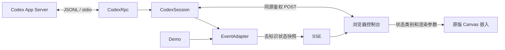

# HaloFlux for Codex 架构

## 原版与桥接边界

| 原版资源 | 职责 |
| --- | --- |
| `index.html` | 按输入设备选择桌面或移动入口。 |
| `lab.html`、`mobile.html` | 原生 Canvas 2D 场景，包含分层光束、缓存网格、环带、彗尾、节拍、BGM 和独立调参控制台。 |
| `wallpaper/` | Wallpaper Engine 入口、调参属性、预览和壁纸音轨。 |
| `LICENSE`、`preview.png`、`audio/` | 原始许可证、预览和 CC0 音轨。 |

[原始资产清单](ORIGINALS.sha256)记录 v0.1.0 工作区升级前的哈希。11 个文件同时与上游提交 `016bef651c4f911f08039ba159d36a6f246ff5d2` 逐字节比对。原版独立入口、调参和壁纸用法保留在 README 原作者章节。

## 模块与生命周期

- `src/codex-rpc.mjs` 启动原生 CLI。请求 ID 关联 Promise，stdout 按 UTF-8 JSONL 分帧。握手、进程关闭和超时统一释放在途 RPC。在途调用上限为 64。协议探测读取本机 CLI 临时生成的 Schema，校验实时模式的安全参数及各审批响应。
- `src/session.mjs` 管理单个选中线程。通过 `thread/list` 分页，使用 `thread/start`、`thread/resume` 和 `thread/unsubscribe` 管理选中线程及其订阅。活动轮次期间禁止切换。子进程断开后最多尝试重连三次，再依据恢复后的线程状态和最近轮次记录恢复可确认状态。未知终态保持未知。SSE 重连发送当前快照，任务提交只由浏览器显式动作发起。
- `src/event-adapter.mjs` 作用域为当前线程和轮次。项目终态阻止旧启动事件回退状态，项目与轮次 ID 用于去重。消息增量按连接到达顺序收集，最终消息使用 `item/completed` 的权威文本。保留最近任务、最多 256 个活跃项目和 200 条时间线记录。SSE 在事件循环内合并快照，限制慢连接的写缓冲，重新连接时立即发送当前状态。
- `src/protocol.mjs` 和 `src/approvals.mjs` 负责从安装版本核对可用决定，并将命令、托管网络、文件、权限与输入映射为独立审查视图和响应。文件请求以项目 ID 关联 `item/started` 和 `item/fileChange/patchUpdated`。无完整预览时只允许拒绝。更详细的边界见[安全模型](SECURITY.md)。
- `src/demo.mjs` 使用独立状态实例和定时事件。模拟操作不触发真实 RPC。页面标明当前信号来源。
- `src/diagnostics.mjs` 将已知错误映射到固定类别，并提供允许列表内的健康报告。原始错误详情只在用户打开的私有任务视图中按原有边界读取。
- `public/renderer.js` 在原版绘制前调整几何、色彩、节拍和粒子。嵌入版关闭隐藏图表定时器并复用近景光束容器。画质档和设置变更仅在有效 DPR 或构图参数变化时重建画布。隐藏时取消主画布帧调度，恢复时重置计时。FPS 与 P95 使用提交绘制前的实际回调时钟。辉光合成、光束层、粒子和 BGM 继续使用原版实现。

同一桥接的标签页各自持有一条 EventSource，订阅同一个实时线程和模拟场景的公共快照。模式、私有详情展开状态和待处理界面请求由各页管理。客户端在断线、模式切换或实时线程作用域变化时清除旧视图，按本页的作用域丢弃晚到的私有读取。重新建连以服务端当前快照恢复。浏览器回归用 SSE 响应和快照验证传输，用 DOM 验证界面，用前台 Canvas 样本验证绘制，分别记录失败阶段。 [双标签复测](DUAL-TAB.md)

## 协议边界

使用 `codex-cli 0.162.0` 生成的 Schema 核对请求与响应。应用支持由 HaloFlux 独立启动的 stdio App Server。该版本 CLI 也提供 daemon/proxy 与带认证的 WebSocket transport。跨客户端共享需要显式配置同一个服务、认证和线程订阅。本版本只提供本地 stdio 连接以及官方线程历史恢复。 [Codex App Server 官方文档](https://learn.chatgpt.com/docs/app-server)

CLI 选择由启动进程解析。默认按绝对 PATH 目录查找原生程序。Windows 下识别 npm shim 旁的官方平台包布局，通过 stdio 直接运行原生文件。进程级 `CODEX_BIN` 可显式选择已信任的绝对路径。实时连接使用该文件生成的 Schema 核对核心方法、事件及安全字段，再验证握手。缺少核心能力时拒绝实时操作，缺少审批响应格式时关闭相关操作。 [Windows CLI 兼容性](SANDBOX.md) · [桌面化决策](DESKTOP-ADR.md)
